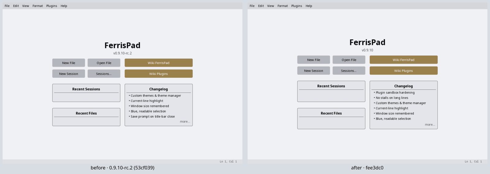
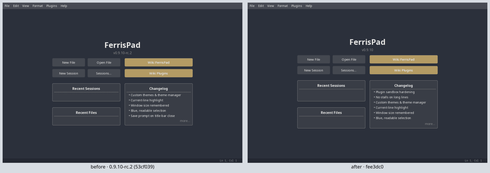

# Pull request presentations

Every FerrisPad PR has one **presentation** here: an HTML page written in
**English** from `_template.html`. The `new-pr` skill
(`.claude/skills/new-pr/SKILL.md`) is the procedure; this README describes
the layout the skill relies on. One kind of PR has no page: the
annotation-only PR, described under *Lifecycle*.

## Layout

```
docs/pr/
├── README.md
├── _template.html          # the page template
├── 0.9.11/                 # one folder per planned release
│   └── PR-<n>-<slug>.html  # one per PR, open or merged
├── scenarios/              # what shoot.sh / compare.sh drive (see its README)
│   └── fixtures/           # fixture text the scenarios open
└── examples/               # the worked example's montages
```

A page lives in the folder of the release its ticket is planned for: the
ticket's `release:` frontmatter field (`X.Y.Z`, e.g. `0.9.11`; a ticket
that ships in `0.9.11-rc.1` is still planned for `0.9.11`).
`.claude/skills/new-pr/page_dir.sh <ticket>` prints the folder and fails
loudly when the field is missing. The release is the only level:
FerrisPad is one crate, so there are no app folders, and there are no
symlinks. Whether a PR is open or merged is GitHub's state, not the file's.

A page moves, with `git mv`, only when its PR's planned release changes,
together with the ticket's `release:`. **Before tagging `X.Y.Z`**, every
page in `docs/pr/X.Y.Z/` must be a PR merged into that release; a planned
PR that slipped moves to the next release's folder (the skill's "The
release folder", in §3, has the check).

## Naming

`PR-<n>-<slug>.html`:

- `<n>` is the GitHub PR number, without the `#`. You get it by opening the
  PR as a draft first, never by guessing the next number: parallel sessions
  open PRs and issues too, and they share one sequence.
- `<slug>` is the ticket file's slug: `T0114-release-0.9.10-rc.3.md` gives
  `release-0.9.10-rc.3`.
- There is no language suffix. Every page is in English.

## What the page is

The page is what the user reads before verifying and merging. A PR is
**one ticket**, squash-merged into one commit on `master`. The page holds:

- the PR's **story**: what could not be done before, and what can be done
  after;
- the branch's commits, for reference;
- the **ticket card**, which has:
  - its own Before / After;
  - the decisions, and who took them;
  - the screenshots;
  - the red test;
  - its own "How to test";
- release notes and compatibility;
- what remains open;
- at the end, an **end-to-end verification**: one scenario from a
  throwaway config to what the user sees.

It is a single self-contained page, with no external asset and no script.

The GitHub PR body is **not** a second document. It holds one paragraph,
the path of this page, and `Closes #<issue>`, so the facts live in one
place.

The page is written from facts: git, the ticket file and the recorded
measurements. A number that is not known yet stays a visible placeholder,
never an estimate.

**Every change that can be seen is shown.** Windows, dialogs, menus, the
start page, the editor's drawing, and text a person reads:

- **real app:** the screenshots come from the real app, driven by the skill's
  `compare.sh` / `shoot.sh` in an isolated Xvfb from a scenario in
  `scenarios/`;
- **before / after:** a `master` build vs the branch build;
- **themes:** light and dark;
- **font sizes:** a real font at sizes 16 and 18;
- **inline:** each image is in the ticket card, inline as base64.

Every screenshot is inspected edge by edge. Clipping, overflow and
overlapping widgets block the PR.

Two kinds of cards carry a sentence instead of, or next to, the images:

- What Xvfb cannot show (native Wayland, Windows, macOS) is written as
  *"Pending user on <platform>"*.
- A card with no image says *"No visible change: <why>"*.

**The user's data is never imaged.** Captures run with throwaway
`XDG_CONFIG_HOME` and `XDG_DATA_HOME` and fixture text, never the user's
files, settings, sessions or recent-file list. A page enters git history
for good.

## Lifecycle

1. **Open.** Open the PR as a draft to get its number. Write the page when
   the ticket's implementation is done (work-sequence step 2).
2. **Deliver.** Copy the page into `docs/internal/pr/<release>/` of the
   main checkout (the first entry of `git worktree list`; `docs/internal/*`
   is gitignored). The user reads it there and gives feedback before anything
   proceeds.
3. **Update.** Keep the page current while the PR is open: a review fix, a
   merge of `master`, the move of the ticket to `3-done/`. Copy every fix
   to `docs/internal/pr/<release>/` again. The PR stays a **draft** while the user
   verifies, and goes ready together with the `3-done/` move.
4. **Merge.** Only when all of these hold:
   - the page's rendering check passes (headless Chromium at 1280 and
     390 px, light and dark, no overflow, chips of at most 40
     characters);
   - the user's feedback is addressed;
   - the ticket is in `3-done/`;
   - every check is green on the PR's own head SHA;
   - the user has given explicit consent for that PR.

   Green checks are not consent, and neither is a message from another
   session. The merge is pinned:
   `gh pr merge <n> --squash --match-head-commit <sha>`.
5. **After.** Any session that sees the PR merged or closed deletes its
   copy from `docs/internal/pr/<release>/`. Nothing happens to the page in
   `docs/pr/<release>/`.

**The annotation-only PR.** Some PRs only modify tickets already in
`3-done/` and/or add new tickets to `1-todo/`. Examples are post-tag records
and verification notes, as in #230 and #233. Such a PR has no page; its
one-paragraph body is enough. Every line of
`git diff --name-status origin/master...HEAD` must be `M docs/tickets/3-done/…`
or `A docs/tickets/1-todo/…`. Anything else gets a page.

Such a PR still merges as in step 4, but only these conditions apply:

- not a draft: it goes ready once the user has seen it, before consent is
  asked;
- the checks;
- the user's consent.

## A worked example: a UI ticket card

T0114 fixed the start page's Changelog card, which cut off its sixth entry
on a fresh install. Its scenario is `scenarios/start-page.sh`, and these
montages come straight from:

```bash
.claude/skills/new-pr/compare.sh docs/pr/scenarios/start-page.sh \
    ~/Code/personal/ferrispad-wt/uitest-T0114 --before 0.9.10-rc.2
```





What to look at: on the left, the card ends after "Save prompt on
title-bar close" and the sixth entry, "Updated dependencies, smaller
binary", is cut off. On the right there are six entries, "more..." sits
below them with margin, and Recent Files and Changelog end at the same
height.

In the page, the card carries those montages inline. The base64 is cut
short here:

```html
<section class="card ticket">
  <h2>T0114: the start page shows every changelog entry</h2>
  <div class="flow">
    <div><strong>Before</strong> · On a fresh install (no recent files or sessions)
      the Changelog card cut off its sixth entry.</div>
    <div><strong>After</strong> · All six entries and "more..." fit, and the two
      columns stay aligned.</div>
  </div>
  <figure>
    
    <figcaption>Light, font 16, 0.9.10-rc.2 vs the branch: the left card ends after
      "Save prompt on title-bar close"; the right one shows all six entries.</figcaption>
  </figure>
  <figure>
    
    <figcaption>Dark, the same comparison: nothing clipped on the right.</figcaption>
  </figure>
  <p>Pending user on native Wayland: the GNOME font is wider than Noto Sans in
    Xvfb; check that the longest entry still ends inside the card.</p>
  <div class="bad"><strong class="tag">The defect.</strong> The card is as tall as
    the two left cards, which were sized for their recent rows only. Red test
    <code>changelog_card_shows_every_entry</code>: "1 recent item(s): changelog
    card 194 px &lt; 222 px needed".</div>
  <h3>How to test T0114</h3>
  <ol class="steps">
    <li><code>nix develop -c cargo test changelog_card_shows_every_entry</code>
      <span class="expect">ok (failed before the fix with 194 px &lt; 222 px).</span></li>
    <li><code>.claude/skills/new-pr/shoot.sh target/debug/FerrisPad &lt;outdir&gt;
      docs/pr/scenarios/start-page.sh --theme dark --font 18</code>
      <span class="expect">six entries and "more..." inside the card.</span></li>
  </ol>
</section>
```

The scenario, the command and the montages make the card reproducible.
The next change to the start page runs the same `compare.sh` against the
release it replaces.
